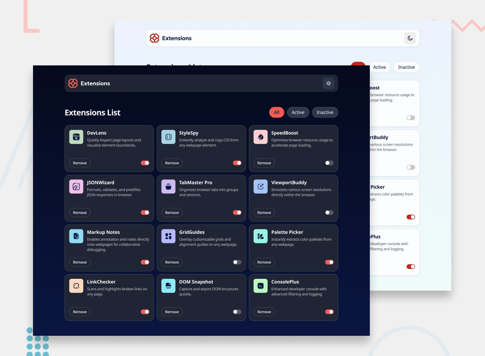

# Browser Extensions Manager UI

## About the Project

**Browser Extensions Manager UI** is a responsive web application designed to help users organize, monitor, and control their browser extensions from a single interface. 

The application dynamically renders extension information, allows users to toggle active states, filters extensions based on status, and supports dark and light themes for an optimal user experience across devices.

## Features

- **Dynamic Data Loading**: Asynchronously fetches and displays extension cards from a local data source (`data.json`).
- **Interactive State Toggling**: Enable or disable extensions with switch controls, updating state in real time.
- **Filter Controls**: Quickly view extensions by category:
  - **All**: Displays all available extensions.
  - **Active**: Filters for currently enabled extensions.
  - **Inactive**: Displays disabled extensions.
- **Remove Extensions**: Delete extensions directly from the dashboard view.
- **Light & Dark Mode**: Toggle between dark and light themes with smooth transitions and dedicated styling.
- **Responsive Design**: Adapts cleanly across mobile, tablet, and desktop viewports using CSS Grid and Flexbox.

## Built With

- **HTML5**: Semantic document structure and accessible elements.
- **CSS3**: Custom properties (CSS variables), CSS Grid, Flexbox, and media queries.
- **JavaScript (ES6+)**: Fetch API, DOM manipulation, and event handling.

## Getting Started

To view the project locally:

1. Clone or download the repository.
2. Open `index.html` in any modern web browser (or serve it using an extension like VS Code's *Live Server*).
